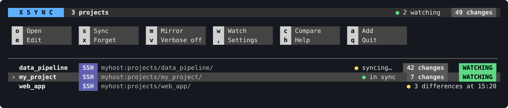
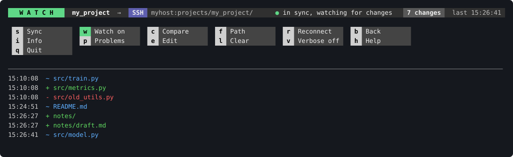
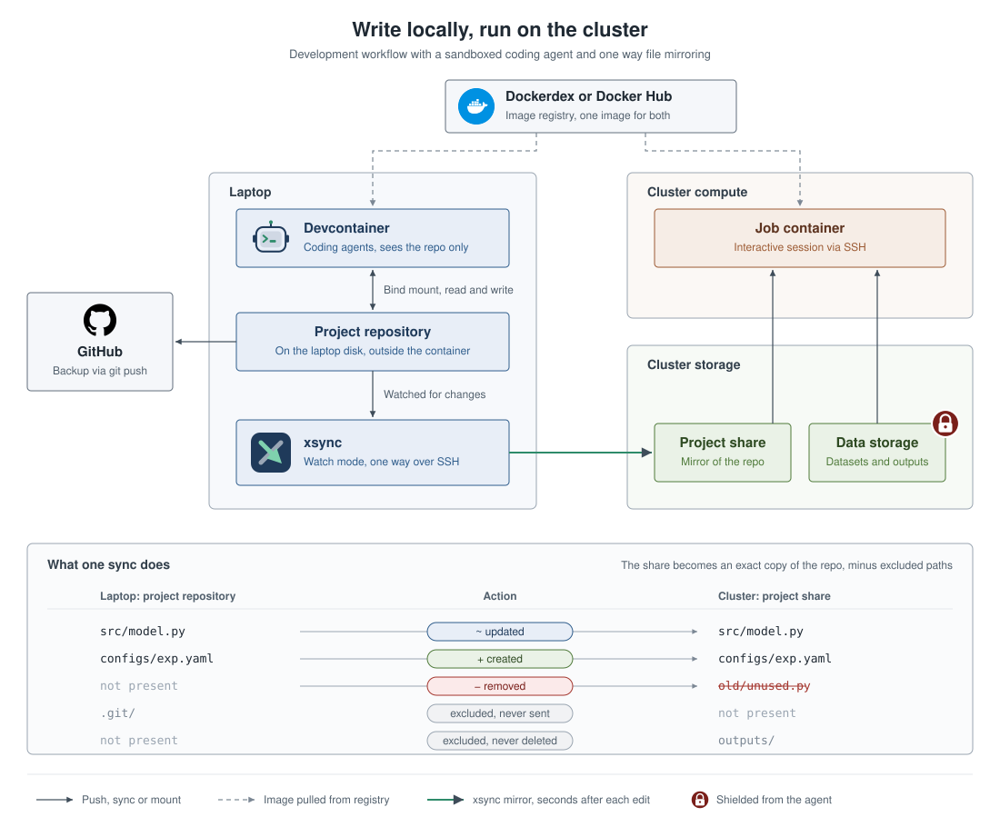

<h1></h1>

[](https://github.com/rospaans/xsync/actions/workflows/ci.yml)
[](LICENSE)
[](https://www.python.org/downloads/)

A small `rsync` wrapper for syncing a local project directory to a server over SSH. One command, one config file per project.





## Recent changes

xsync is now an interactive tool for SSH remotes. You run `xsync` in a terminal and do everything with single keys; the old command-line modes (`xsync file.py`, `--dry-run`, `--watch`, `--interval`) are gone.

- **One place for all projects**: xsync remembers every project you run it in. Run `xsync` anywhere to get an overview of all of them, open one, and switch between them. Watch mode keeps running for each project it is on, so one terminal window is enough.
- **Interactive session**: a fixed status bar, a grid of buttons and a scrolling list of changes. Keys: sync, watch on/off, compare, sync one file or folder, reconnect, info, errors, verbose, help, back, quit.
- **SSH first**: `remote` is `host:/path/`, with `host` an alias from `~/.ssh/config`. Local paths and mounted volumes still work; see "Optional: local paths and mounted volumes".
- **No remote shell commands**: syncing, deleting and the reachability check all go through rsync, so odd filenames cannot inject commands and xsync works with an SSH key restricted to rsync (see "Restricting xsync to one remote folder").
- **Stays inside the remote folder**: paths that are absolute or contain `..` are never synced or deleted, and a `remote` containing `..` is refused.
- **`--delete` guard**: xsync refuses to start when the remote path is empty, `/`, `~`, `.` or a home directory. A missing trailing `/` on `remote` is added automatically.
- **Keeps up with bursts**: after many changes at once, the touched folders are checked against the server, so nothing the file watcher missed is left behind.
- **Leaves nothing behind**: the lists xsync hands to rsync are written to the system's temp folder, not into your project, so they are never synced or watched.
- **Never looks frozen**: a running sync shows its elapsed time and can be cancelled with Esc.
- **Survives connection drops**: the server is checked once a minute, changes made while offline are queued and retried, and a dead connection is noticed instead of hanging.
- **Watch mode cleans up**: deleted files are removed from the remote, and so are folders once they are empty there.
- **Fail fast**: an unreachable SSH host (down, key not loaded, VPN off) shows as `OFFLINE` within seconds; xsync keeps running and retries.
- **rsync flavor**: xsync uses `/opt/homebrew/bin/rsync` if present, else `rsync` from `PATH`. With anything other than GNU rsync 3.x it warns and shows rsync's raw output. An optional `rsync = "/path/to/rsync"` key overrides the choice (see Troubleshooting).
- **Extra rsync flags**: optional `rsync_args = [...]` key, for example for server folders on storage that rejects permission, ownership or timestamp changes (see "Remotes on a network share").
- **A package, not one script**: the code lives in `src/xsync/`, split by responsibility, with tests in `tests/`. See "Development".

## What it does

`xsync` reads a `.xsync.toml` file from the project root and uses `rsync` over SSH to keep the `remote` folder declared there identical to your local project. It is one command on your `$PATH`; each project only needs a declarative config. Syncing is one way: local to remote.

You run `xsync` in a terminal and press a key:

- **Compare** shows what differs between the project and the server, changing nothing.
- **Sync** mirrors the project to the remote, respecting an exclude list.
- **Watch** keeps the remote up to date while you, or coding agents, edit files.
- **Path** pushes one file, or mirrors one folder.

xsync remembers your projects. Inside a project folder it opens that project; anywhere else it shows an overview of all of them, and watch mode keeps running for every project it is switched on for.

A typical setup: a coding agent edits the project inside a devcontainer on your laptop, and xsync, running outside the container, mirrors every edit to the cluster within seconds. Jobs on the cluster use that copy together with data the agent can never reach.



## Requirements

- Python 3.11+ (for `tomllib` in the standard library)
- GNU rsync 3.x, on your machine and on the server. macOS ships a different rsync (openrsync) that fails against many servers, so install GNU rsync first; see step 1 below.
- Key-based SSH login to the server through a host alias in `~/.ssh/config` (see "SSH setup")
- `watchdog` for watch mode (installed by `install.sh`)
- A terminal: xsync is interactive and does not run from scripts

## Getting started

The whole setup, in order. Each step links to its section.

1. **Install GNU rsync and xsync** ([Installation](#installation)).
2. **Make an SSH alias for the server** that logs in with a key ([SSH setup](#ssh-setup)).
3. **Optional: restrict that key to one folder on the server** ([Restricting xsync to one remote folder](#restricting-xsync-to-one-remote-folder)).
4. **Add your first project in xsync and sync it** ([Setting up a new project](#setting-up-a-new-project)).

Steps 1 to 3 are done once per machine and server. Step 4 is done once per project.

## Installation

**Step 1. GNU rsync.** On macOS:

```bash
brew install rsync
```

Then **open a new terminal window**, so that the new rsync is found instead of the one macOS ships, and check:

```bash
rsync --version
```

The first line must read `rsync  version 3.x`. If it says `openrsync` or `version 2.6.9`, the terminal still finds the old one: open a new window, or see "rsync warning about not GNU rsync 3.x" in Troubleshooting. On Linux, your package manager's `rsync` is already GNU rsync.

**Step 2. xsync.**

```bash
git clone https://github.com/rospaans/xsync.git
cd xsync
bash install.sh
```

The installer warns if the terminal does not find GNU rsync 3.x.

The installer:

- creates a private Python environment in `~/.local/share/xsync/venv`, so nothing is added to your system Python;
- installs xsync and `watchdog` (used by watch mode) into it;
- links the `xsync` command into `~/.local/bin` and, if needed, adds that folder to your `PATH` in `~/.zshrc` or `~/.bashrc`. Restart your shell or `source` the rc file afterwards.

To update, pull the changes and run `bash install.sh` again. Or let xsync do it: press `,` in the overview for the settings, then `u` (see [Settings and updates](#settings-and-updates)).

If you manage Python tools yourself, `pipx install '.[watch]'` or `uv tool install '.[watch]'` from the checkout does the same.

## SSH setup

This is done once per server, before any project is configured. xsync never asks for a password. It needs a host alias in `~/.ssh/config` that logs in with a key.

```
Host myhost
    HostName server.example.org
    User you
    IdentityFile ~/.ssh/id_ed25519
    ControlMaster auto
    ControlPath ~/.ssh/cm-%n-%r-%p
    ControlPersist 10m
```

The three `Control*` lines are optional. They keep one connection open and reuse it, which makes repeated syncs and watch mode much faster. Keep `%n` (the alias name) in `ControlPath`, so that two aliases for the same server never share a connection.

Check that it works without a prompt:

```bash
rsync --list-only myhost:.
```

It lists your home folder on the server. If it prints rsync errors instead (for example about the protocol or an unexpected tag), run `rsync --version` first: it must say `rsync  version 3.x`. See [Installation](#installation).

The alias (`myhost`) is what each project's `remote` line will refer to.

## Restricting xsync to one remote folder

Optional but recommended on shared storage. Like the SSH setup, this is done once, before configuring projects.

xsync only addresses paths below `remote`. But the SSH login it uses can normally reach everything your account can, including other people's folders on shared storage. A wrong `remote` or a bug could therefore damage files outside your project.

You can rule that out on the server with a dedicated SSH key that is only allowed to run rsync inside one folder. Connections with that key cannot see or change anything outside it, whatever xsync or its config says. This uses `rrsync`, a script that ships with rsync.

Pick the folder that should be the boundary. A good choice is your own top-level folder on the storage: every project below it can then share one key, and the worst a mistake can do is affect your own files.

### One-time setup

The steps use these example values. Replace them with your own wherever they appear:

| Example | Meaning |
|---|---|
| `myhost` | your existing SSH alias for the server |
| `myhost-sync` | the new, restricted alias you are creating |
| `server.example.org`, `you` | the server's address and your username there |
| `/data/projects/you` | the boundary folder on the server |

Every command says where to run it: on **your machine** or on **the server**.

**Step 1. Find `rrsync` on the server.** On your machine:

```bash
ssh -T myhost 'command -v rrsync'
```

It prints a path, usually `/usr/bin/rrsync`. The steps below assume that path. If it prints nothing, ask the administrator to install it (it is part of the rsync package).

**Step 2. Create a dedicated key.** On your machine:

```bash
ssh-keygen -t ed25519 -f ~/.ssh/xsync_ed25519 -C xsync
```

Press Enter twice to leave the passphrase empty, so xsync can use the key without a prompt.

**Step 3. Allow that key on the server, limited to the folder.** The server needs one new line in `~/.ssh/authorized_keys`: the restriction, followed by your new public key. You do not have to assemble it by hand. On your machine, this command builds the line and appends it on the server (change the folder path first):

```bash
echo "command=\"/usr/bin/rrsync /data/projects/you\",restrict $(cat ~/.ssh/xsync_ed25519.pub)" | ssh -T myhost 'cat >> ~/.ssh/authorized_keys'
```

Run it once only; running it again adds the line twice. Then check that it arrived:

```bash
ssh -T myhost 'tail -n 1 ~/.ssh/authorized_keys'
```

You should see a single line like this:

```
command="/usr/bin/rrsync /data/projects/you",restrict ssh-ed25519 AAAAC3Nza...long-key... xsync
```

**Step 4. Add the restricted alias.** On your machine, open `~/.ssh/config` and add this block at the end:

```
Host myhost-sync
    HostName server.example.org
    User you
    IdentityFile ~/.ssh/xsync_ed25519
    IdentitiesOnly yes
```

Use the same `HostName` and `User` as your existing `myhost` entry. Keep that entry as it is; it stays your alias for normal logins.

If you use connection sharing (`ControlMaster`), make sure the `ControlPath` contains `%n`, as in "SSH setup". With a path based only on user and server, the restricted alias would reuse an open connection from your normal alias and inherit its unrestricted access.

Then check whether the file has a `Host *` block containing an `IdentityFile` line. If it does, change `Host *` to `Host * !myhost-sync`. Without this, SSH offers your normal key first, the server accepts it, and the restriction is silently skipped. A complete file would look like this:

```
Host * !myhost-sync
    IdentityFile ~/.ssh/id_ed25519

Host myhost
    HostName server.example.org
    User you

Host myhost-sync
    HostName server.example.org
    User you
    IdentityFile ~/.ssh/xsync_ed25519
    IdentitiesOnly yes
```

**Step 5. Verify the restriction.** On your machine, run these three commands and compare the results. If the first one fails with rsync errors rather than listing a folder, check `rsync --version` first (see [Installation](#installation)); the macOS rsync does not work with `rrsync`.

```bash
rsync --list-only myhost-sync:.
```

Lists the contents of your boundary folder. The key works.

```bash
ssh myhost-sync
```

Must be refused, with a message like `rrsync error: Not invoked via sshd`. This key cannot open a shell, so you cannot log in and look around with it. If you get a normal shell instead, SSH is using your unrestricted key: go back to the `Host *` change in step 4.

```bash
rsync --list-only myhost-sync:../
```

Must be refused, with a message like `rrsync error: do not use .. in arg`. Nothing above the boundary folder is reachable.

**Step 6. Use the restricted alias in each project.** There are now two levels, each set in one place:

| Level | Set where | Example |
|---|---|---|
| The boundary: the outer limit for everything xsync does | Once, in the `authorized_keys` line on the server (step 3) | `/data/projects/you` |
| The project folder inside the boundary | Per project, in the `remote` line of its `.xsync.toml` | `myhost-sync:research/project_1/` |

In `remote`, use the restricted alias and write the path relative to the boundary folder, not as a full path:

```toml
remote = "myhost-sync:research/project_1/"
```

This syncs to `/data/projects/you/research/project_1/` on the server. For several projects:

| Local folder (contains `.xsync.toml`) | `remote` in that file | Ends up on the server at |
|---|---|---|
| `~/work/project_1/` | `myhost-sync:research/project_1/` | `/data/projects/you/research/project_1/` |
| `~/work/project_2/` | `myhost-sync:research/project_2/` | `/data/projects/you/research/project_2/` |

The key keeps every project inside the boundary. The `remote` line keeps each project in its own folder.

**That is the server side done.** Next, add your first project in xsync, using the restricted alias in its `remote` line. In short:

1. `cd` into your project folder and run `xsync`.
2. Press `a`, type `.` (this folder) and press Enter. xsync creates the project's `.xsync.toml` and opens it in your editor.
3. Set the `remote` line, for example `remote = "myhost-sync:research/project_1/"`, then save and close the editor.
4. Back in xsync, press `c` to compare (nothing changes), then `o` to open the project and read the list.
5. If the list looks right, press `s` to sync, or `w` to sync and keep watching.

[Setting up a new project](#setting-up-a-new-project) explains each step.

### Adding another folder

A key is tied to exactly one folder. To sync into a second, unrelated folder, repeat steps 2 to 5 with a new key file name (for example `~/.ssh/xsync_other_ed25519`), the other folder's path and a new alias name. Add the new alias to the `Host *` exclusion as well (`Host * !myhost-sync !myhost-other`). The server's `authorized_keys` then has two lines:

```
command="rrsync /data/projects/you",restrict ssh-ed25519 AAAA... xsync
command="rrsync /data/other/folder",restrict ssh-ed25519 AAAA... xsync-other
```

Each project then chooses its boundary through the alias in its `remote`. Do not widen one key to a parent folder that also contains other people's files; that removes the protection.

### Requirements for this setup

- GNU rsync 3.1 or newer on both machines, because watch mode removes deleted files through rsync rather than a shell command.
- New projects are created inside the boundary folder automatically, but their parent folder (`research/` in the example) must already exist.

## Configuration

Each project is configured by one file, `.xsync.toml`, in the project root. The next section shows how to create it; this is what it contains:

```toml
# Where to sync to: "<ssh alias>:<folder on the server>/"
remote = "myhost:/path/to/project/"

# Files and folders to skip (rsync exclude syntax)
exclude = [
    ".git/",
    ".venv/",
    "__pycache__/",
    "*.pyc",
    ".DS_Store",
    "node_modules/",
    "data/",
    "outputs/",
]

# --- Optional settings: remove the leading "# " from a line to use it ---
# A local path instead of SSH (replaces the remote line above)
# remote = "/Volumes/your-volume/your-project/"

# Seconds watch mode collects changes before sending them (default 2)
# interval = 2

# Extra rsync flags. This set is for a server folder on a network share (CIFS/SMB)
# that rejects permission, ownership and timestamp changes; see the README.
# rsync_args = ["--no-perms", "--no-owner", "--no-group", "--no-times", "--omit-dir-times", "--inplace", "--checksum"]
```

| Setting | Required | Meaning |
|---|---|---|
| `remote` | yes | Where to sync to. |
| `exclude` | no | Files and folders to skip, in rsync's pattern syntax. `checkpoints/` skips every folder of that name, at any depth; `/checkpoints/` only the one at the top of the project. |
| `interval` | no | Seconds watch mode collects changes before sending them. Default 2. |
| `rsync_args` | no | A list of extra flags passed to rsync, placed after xsync's own so they can override them. |

The `remote` field is an SSH target in the form `host:/path/`, where `host` is an alias from `~/.ssh/config`. `user@host:/path/` also works.

Full syncs delete remote files that do not exist locally, so point `remote` at a folder used only for this project, and press `c` to compare before the first real sync. Files matching `exclude` are never deleted on the remote.

## Setting up a new project

This assumes the SSH alias exists (see "SSH setup").

Nothing is mounted. xsync copies one local folder to one folder on the server, and each side is specified in its own place:

| What | Where it is specified |
|---|---|
| The local folder to sync | Not written down. It is the folder that contains `.xsync.toml`. |
| The folder on the server | The `remote` line in that `.xsync.toml`. |
| Which files to skip | The `exclude` list in that `.xsync.toml`. |

Each project has its own `.xsync.toml`, so each project syncs to its own folder on the server and nowhere else.

**Step 1. Add the project.** Run `xsync` in the root of your local project and press `a`, type `.` for the current folder, and press Enter. Any other folder works too: type its path, pressing Tab to complete folder names as in a shell (when several fit, they are listed), or drag the folder into the terminal.

```bash
cd /path/to/my_project
xsync
```

xsync creates a starter `.xsync.toml` there and opens it in your editor (`$VISUAL`, `$EDITOR`, or nano). `xsync --init` creates the same file without opening anything.

**Step 2. Set the destination.** Edit the `remote` line: the SSH alias, a colon, then the folder on the server, ending in `/`.

```toml
remote = "myhost:/data/projects/you/my_project/"
```

Use a folder that belongs to this project alone. A full sync deletes anything in it that does not exist locally (except files matching `exclude`). The folder itself is created on the first sync if its parent exists. Until `remote` is changed from the starter value, xsync refuses to sync the project.

**Step 3. Adjust `exclude`.** Add folders that should stay only on one side, such as large data or results produced on the server.

**Step 4. If the server folder is on a network share,** you may need an `rsync_args` line. See "Remotes on a network share".

**Step 5. Compare, then sync.** Save and close the editor. Back in the overview, with the project highlighted, press `c` to compare, then `o` to open it and read the list: it shows what would be copied (`+`, `~`) or deleted (`-`) on the server, and nothing has changed yet. Check the remote shown in the bar and the `-` lines in particular. If it looks right, press `s` to sync, or `w` to sync and keep watching. To change the config later, press `e`.

**Several projects** each get their own config and their own server folder:

| Local folder (contains `.xsync.toml`) | `remote` in that file |
|---|---|
| `~/work/project_1/` | `myhost:/data/projects/you/project_1/` |
| `~/work/project_2/` | `myhost:/data/projects/you/project_2/` |

Add `.xsync.toml` to the project's `.gitignore` if the remote path is personal, or commit it if it is generic enough to share.

If you use a restricted key (see "Restricting xsync to one remote folder"), `remote` uses the restricted alias and a path relative to the boundary folder instead: `myhost-sync:my_project/`.

## Remotes on a network share

If the folder on the server is itself a network share that the server has mounted (CIFS/SMB, some NFS setups), the server may refuse to change permissions, ownership or timestamps. rsync then reports errors like these and exits with code 23, even though file contents arrive:

```
rsync: failed to set times on "...": Operation not permitted (1)
rsync: mkstemp "..." failed: Operation not permitted (1)
```

xsync has no built-in setting for this, because what a share refuses differs from one to the next. Use `rsync_args` in `.xsync.toml` to switch off only what yours rejects. Match each error to a flag:

| Error mentions | Add to `rsync_args` | Effect |
|---|---|---|
| `failed to set permissions` | `--no-perms` | Do not set permissions. |
| `chown` or `chgrp` | `--no-owner`, `--no-group` | Do not set ownership. |
| `failed to set times` on a folder | `--omit-dir-times` | Do not set modification times on folders. |
| `failed to set times` on a file | `--no-times`, `--checksum` | Do not set modification times on files, and detect changes by content instead. |
| `mkstemp ... failed` | `--inplace` | Write files directly instead of through a temporary file. |

Add flags until a sync (`s`) runs without `!` lines. As an example, a share that refuses all of the above needs:

```toml
rsync_args = ["--no-perms", "--no-owner", "--no-group", "--no-times", "--omit-dir-times", "--inplace", "--checksum"]
```

`--checksum` makes a full sync read every file on both sides. That is quick for code, but slow if large data files are not excluded. Syncing one file and watch mode are not affected.

## Usage

```bash
xsync                      # the overview of all projects
xsync --verbose            # the same, showing rsync's raw output
xsync --init               # create a starter .xsync.toml in current dir
xsync --version            # show the version
xsync --help               # show usage
```

Run one `xsync` at a time: it handles all your projects from one window, and a second one is turned away so that two never sync the same project over each other.

`xsync` always opens the overview, and starting it does nothing by itself: it does not compare, sync or contact a server until you press a key. Anything else on the command line is an error, and xsync needs a terminal: it never syncs from a script or because of a typo.

### The overview

xsync remembers each project the first time you run it there (it walks up from the current directory to find `.xsync.toml`, so any subfolder works), and highlights it. Projects can also be added from the overview with `a`.

```
   X S Y N C     3 projects                                                         ● 2 watching    49 changes

  o  Open           s  Sync           w  Watch          c  Compare        a  Add
  e  Edit           x  Forget         v  Verbose off    ,  Settings       h  Help
  q  Quit

──────────────────────────────────────────────────────────────────────────────────────────────────────────────
   data_pipeline    SSH  myhost:projects/data_pipeline/                      ● syncing…    WATCHING     42 changes
 › my_project       SSH  myhost:projects/my_project/     ● in sync, watching for changes    WATCHING     7 changes
   web_app          SSH  myhost:projects/web_app/                                          ● 3 differences at 15:20
```

Each row is a project: its name, where it syncs to, what it is doing, a green `WATCHING` tag while watch mode is on, and how many changes it has sent. The rows are in alphabetical order, and `›` marks the highlighted one.

| Key | Action |
|---|---|
| `↑` `↓` | Move the highlight (`k` and `j` work too). |
| `o` | Open the highlighted project (Enter and `→` work too). |
| `s` | Sync the highlighted project now. |
| `w` | Switch watch mode on or off for the highlighted project. |
| `c` | Compare the highlighted project with the server, changing nothing. |
| `a` | Add a project: type, paste or drag its folder and press Enter (`.` is the folder you started xsync in; Tab completes folder names; Esc cancels). A folder without a `.xsync.toml` gets a starter one, which opens in your editor so you can set `remote`. |
| `e` | Edit the highlighted project's `.xsync.toml` in your editor. When you close the editor, xsync reads the file again. |
| `x` | Forget the highlighted project: it leaves this list and stops being watched. No file is touched, locally or on the server, and `a` adds it back. |
| `v` | Verbose on or off, for all projects. |
| `,` | Settings: check for a newer version of xsync and update it. |
| `h` | Help. |
| `q` | Quit. Ctrl+C works too. |

**Projects keep working in the background.** Watch mode stays on for every project you switched it on for, whichever view is on screen, and each project keeps its own list of changes, which you see again when you open it. One sync runs at a time, so a long sync in one project briefly delays the others.

**A project that cannot be synced** (its folder is gone, the config is invalid, `remote` is unsafe or still the starter placeholder) stays in the list with the reason in place of its state, until you fix it with `e` or forget it with `x`.

**The editor** is `$VISUAL`, else `$EDITOR`, else `nano`. Editing a project's config with `e` switches its watch mode off; switch it on again afterwards.

**A config saved from another editor** (VS Code, say) is noticed too: xsync reads it again within a second or two. Watch mode then stays on when `remote` and the rsync settings are unchanged, so a new `exclude` entry or `interval` applies at once. If `remote`, `rsync` or `rsync_args` changed, watch mode is switched off.

**Where the list is kept:** `~/.config/xsync/projects.toml` (or under `$XDG_CONFIG_HOME`). It only holds folder paths and is managed by xsync.

### Settings and updates

Press `,` in the overview. The settings screen shows your version, the checkout xsync was installed from, and the version on GitHub. When a newer version is available, a yellow line at the top says so and the `u` button is green.

| Key | Action |
|---|---|
| `c` | Check for updates: look on GitHub for a newer version now. |
| `u` | Update: checks GitHub first, and only when there is a newer version runs `git pull --ff-only` in the checkout xsync was installed from, then `bash install.sh`. You type `yes` first. Quit and start xsync again afterwards to use the new version. |
| `a` | Check at start on or off. |
| `b` | Back to the overview (Esc and `←` work too). |

**Check at start** (on by default): each time xsync starts, it looks up the version on GitHub's `main` branch in the background. If that is newer than yours, the overview shows a yellow line saying so. Nothing else is sent. Setting `XSYNC_NO_UPDATE_CHECK=1` switches it off too, whatever the setting says. The setting is kept in `~/.config/xsync/settings.toml`.

**Update** only works on a checkout that is on `main` and has no uncommitted changes. Anything else (your own branch, local edits) is left alone, and xsync says why. If the pull cannot fast-forward, nothing is installed.

A "newer version" means a higher `__version__` in `src/xsync/__init__.py`, so raise it with every change worth installing.

### A project

Press `o` on a project in the overview to open it. After `c` (compare, like `git status`) it looks like this:

```
 XSYNC   my_project  →   SSH  myhost:/data/projects/you/my_project/                   ● 3 differences at 15:52    0 changes

  s  Sync           w  Watch off      c  Compare        f  Path           r  Reconnect      b  Back
  i  Info           p  Problems       e  Edit           l  Clear          v  Verbose off    h  Help
  q  Quit

────────────────────────────────────────────────────────────────────────────────────────────────────────────────────────
15:52:10  ~ src/model.py  (not synced)
15:52:10  + notes/plan.md  (not synced)
15:52:10  - old/unused.py  (not synced)
15:52:10  3 difference(s), nothing changed; press s to sync
```

The top of the screen stays fixed; changes scroll below it. On a narrow terminal the buttons wrap into more rows, down to one per line, so their labels stay readable.

| Key | Action |
|---|---|
| `s` | Sync the whole project now. |
| `w` | Switch watch mode on or off. Switching it on does a full sync first, then sends changes as you make them. |
| `c` | Compare: list what differs between the project and the server, without changing anything. |
| `f` | Sync one file or folder. Type, paste or drag a path into the terminal and press Enter (Esc cancels). A folder is mirrored like a full sync, limited to that folder. |
| `r` | Check the connection now and, when it is back, send what was queued. |
| `b` | Back to the overview of all projects (Esc and `←` work too). The project keeps watching if watch mode is on. |
| `i` | Info: the version, project, config file, remote, whether the host answers, and the rsync and flags in use. |
| `p` | Problems: list the warnings and errors recorded so far, and clear the problem line. |
| `e` | Edit this project's `.xsync.toml` in your editor; xsync reads it again when you close the editor, with watch mode switched off. A save from another editor is picked up as well, and keeps watch mode on (see above). |
| `l` | Clear this project's list. Nothing else changes. |
| `↑` `↓` `PgUp` `PgDn` `Home` `End` | Scroll back through the list. The mouse wheel works too in most terminals. |
| `v` | Verbose on or off: show rsync's raw output in place of the one-line-per-change list. |
| `h` | Help: what each key does. |
| `q` | Quit xsync, for all projects. Ctrl+C works too. |

**The bar** shows, from left to right: the mode (`XSYNC` when idle, `WATCHING` with dots that count up while watch mode is on, or `OFFLINE`), the project, an `SSH` or `LOCAL` tag with the remote, the current state behind a dot, the number of changes sent, and the time of the last one. The dot is green when in sync, yellow when busy or when there are differences, and magenta for problems.

**The buttons** show state too: the key cap of `w` and `v` is green while that mode is on, and `r` turns magenta when the connection is lost.

**The line under the buttons** is empty when all is well. It shows the most recent warning or error until you press `p`, and the input prompt after `f`.

**The list** has one line per change, with the time:

| Mark | Color | Meaning |
|---|---|---|
| `+` | green | New on the remote. |
| `~` | blue | Updated on the remote. |
| `-` | red | Deleted from the remote. |
| `!` | yellow | A message or warning from rsync or SSH, shown as received. |
| `!` | magenta | A failure reported by xsync, such as a lost connection or rsync's exit code. |

After a compare the lines end in "(not synced)": they show what a sync would do.

**Scrolling back.** xsync keeps the last 2000 lines of each project. `↑` and `PgUp` (or the mouse wheel) go back through them, `↓` and `PgDn` forward, `Home` to the oldest and `End` to the newest. While you are scrolled back, a yellow line under the buttons says so, and new changes are kept but do not move what you are reading. Any action key returns to the newest line first.

xsync uses the terminal's alternate screen, like an editor does: when you quit, the terminal shows what was there before, and xsync's lists are gone.

### Watch mode

Press `w`. xsync does a full sync and then sends changes as they happen, in batches collected over the `interval` (2 seconds by default):

```
 WATCHING   my_project  →   SSH  myhost:/data/projects/you/my_project/           ● in sync, watching for changes    4 changes   last 15:26:41

15:26:27  + notes/draft.md
15:26:31  ~ src/model.py
15:26:41  - notes/draft.md
15:26:41  - notes/
```

- **Deleted files** are removed from the remote. A folder that disappears locally is removed too, but only once it is empty on the remote, so files that exist only on the server are never touched.
- **Excluded paths** are ignored in both directions: changes to them are not sent, and they are never deleted on the remote. A path you add to `exclude` while watching is skipped from then on, but copies already on the remote stay there; xsync lists the new patterns as a reminder, and removing those copies is up to you.
- **Files still being written**, such as a download or a growing log, are not sent over and over. A file that has changed again by the very next batch after it was sent waits until it has been unchanged for 3 seconds (the status says `waiting for N file(s) still being written`). One that never stops changing is still sent once a minute. A file you save again a few seconds later is sent right away.
- **Switching watch off** stops sending. Switching it on again starts with a full sync, so nothing is missed. This is useful around a `git checkout` or a large refactor.
- **After a burst** of 100 or more changes, such as a coding agent rewriting many files or a branch switch, xsync waits until things have been quiet for a few seconds and then checks the folders that were touched against the server, sending or deleting whatever does not match. When very many files change at once the system's file watcher can miss some, and this check catches them. You see it as `checked N folder(s) after a burst`.

### While a sync runs

xsync does one thing at a time, so keys other than the ones below wait until the running sync is done. After three seconds the status shows how long it has been running, for example `syncing…  ·  12s, Esc cancels`.

- **Esc** cancels the running sync. In watch mode this also switches watch off for that project; switch it on again to catch up with a full sync.
- **The scroll keys** keep working.

A sync that seems stuck is usually waiting on the server: a full disk, a stalled network share, or a dropped connection that has not timed out yet.

### When the connection drops

xsync keeps running. For every project you are watching or have run an action on, it checks the server once a minute even when nothing changes, so a dropped VPN shows up without waiting for an edit. When offline, the badge reads `OFFLINE`, changes made in watch mode are queued, and xsync retries every 10 seconds. `r` retries immediately. When the server answers again, the queued changes are sent.

The terminal tab title shows the project and state, so you can see it when the terminal is in the background.

## How it works

- **Compare** (`c`): the same rsync run as a full sync with `--dry-run`, so it reports exactly what a sync would do.
- **Full sync** (`s`): invokes `rsync -az --delete` over SSH with the exclude list. The remote becomes an exact mirror of the local project, minus excluded paths.
- **File or folder sync** (`f`): a file is transferred to the same relative path under the remote root, creating missing folders. A folder is mirrored like a full sync, limited to that folder.
- **Watch** (`w`): one full sync, then pushes changed files in batches and removes deleted files from the remote. Failed batches are retried when the connection returns.
- **SSH options**: over SSH, xsync runs rsync with `ssh -T -o BatchMode=yes -o ConnectTimeout=10 -o ServerAliveInterval=15 -o ServerAliveCountMax=3`, so it never waits for a password and notices a dead connection. If you set `RSYNC_RSH`, or pass your own `-e` in `rsync_args`, yours is used instead.

## Optional: local paths and mounted volumes

SSH is the recommended setup. `remote` can also be a path on your own machine, such as a mounted network volume or an external drive:

```toml
remote = "/Volumes/your-volume/your-project/"
```

`~/some/folder/` works too. Differences from an SSH remote:

- No SSH alias or key is needed, and no reachability check runs. If the volume is not mounted, rsync reports the error.
- Compression (`-z`) is switched off, since nothing travels over a network connection that rsync controls.
- Watch mode removes deleted files directly on the mounted path.
- The same `--delete` guard applies: the path must not be `/`, your home directory or the current directory.
- A mounted share can reject permission or timestamp changes in the same way as a server-side one. If you see "Operation not permitted", see "Remotes on a network share".

## Troubleshooting

**A project says "set 'remote' in .xsync.toml first"**
Its config still has the starter value. Press `e`, set `remote`, save and close the editor.

**"cannot reach '<host>' over SSH"**
The host is down, your key is not loaded (`ssh-add`), or the VPN is not connected. Check with `rsync --list-only <host>:.`.

**"refusing to sync with --delete"**
The `remote` path is empty, `/`, or a home directory. Point it at a dedicated project directory.

**"not found inside the project"**
The file or folder entered with `f` does not exist, or is not inside the project root. `xsync` only syncs paths within the project.

**xsync seems stuck on "syncing…"**
It is waiting for rsync, which is waiting for the server. The status shows for how long. Press Esc to cancel, then check the server: free space on the share, the VPN, and `r` (reconnect) in the project.

**Something is off and I don't know where to start**
Open the project and press `i`. It shows the project, remote, rsync binary and flags in use, and whether the server answers.

**I need to see exactly what rsync did**
Press `v` (or start with `xsync --verbose`) and repeat the action to get rsync's raw output.

**Exit code 23 from rsync**
Some files or attributes could not be transferred. If the errors say "Operation not permitted", see "Remotes on a network share".

**Works with my normal alias but not with the restricted one**
Check that `remote` is relative to the boundary folder (`myhost-sync:research/project_1/`, not an absolute path), that the parent folder exists, and that `rsync --list-only myhost-sync:.` works.

**`rsync --list-only` prints errors instead of a listing**
Usually the terminal is using the rsync macOS ships, which does not work with many servers or with `rrsync`. Run `rsync --version`: the first line must read `rsync  version 3.x`. If not, run `brew install rsync`, open a new terminal window, and check again. A window that was already open keeps finding the old rsync.

**rsync warning about "not GNU rsync 3.x"**
macOS ships a different rsync. Run `brew install rsync`; xsync picks up `/opt/homebrew/bin/rsync` automatically. For the `rsync` commands you type yourself, open a new terminal window afterwards.

**xsync uses the wrong rsync**
xsync runs `/opt/homebrew/bin/rsync` if it exists, and otherwise the first `rsync` on your `PATH`. If your GNU rsync is installed somewhere else (for example `/usr/local/bin/rsync` on an Intel Mac), the warning above keeps appearing or flags are rejected. Check what you have:

```bash
which -a rsync                  # every rsync on your PATH
/path/to/rsync --version        # GNU rsync prints "rsync  version 3.x"
```

Then point xsync at the right one by adding this line to the project's `.xsync.toml`:

```toml
rsync = "/usr/local/bin/rsync"
```

This setting is not in the starter config because the automatic choice is right in most setups.

## Development

```bash
git clone https://github.com/rospaans/xsync.git
cd xsync
python3 -m venv .venv && . .venv/bin/activate
pip install -e '.[dev]'
python -m pytest                 # the test suite
python -m xsync                  # run from the checkout
```

The code is in `src/xsync/`:

| Module | What it holds |
|---|---|
| `cli.py` | The command line: `--help`, `--version`, `--init`, and starting the app. |
| `app.py` | The hub: the overview of all projects, one project's view, key handling, and the loop that drives both. |
| `project.py` | One project: loading its config, compare, sync, watch mode and its queue, the after-burst check, connection state. |
| `rsync.py` | Everything that runs rsync: full syncs, single paths, watch-mode batches and deletes, and reading rsync's output. |
| `remote.py` | The `remote` setting: telling SSH targets from local paths, and refusing dangerous ones. |
| `excludes.py` | The exclude check watch mode uses, matching rsync's patterns. |
| `config.py` | The starter config, finding a project's folder, the list of known projects, and xsync's own settings. |
| `update.py` | Checking GitHub for a newer version, and updating from the checkout xsync was installed from. |
| `ui.py` | Drawing the fixed rows of a view, and reading keys from the terminal. |
| `output.py` | The small shared state, colors, and the lines that end up in a project's list. |

Most tests in `tests/` call these functions directly, against scratch folders. A few run the real file watcher, including a burst of 3000 file changes. `tests/test_terminal.py` runs xsync as a whole in a pseudo-terminal, pressing keys and reading the screen. One optional test syncs over `ssh localhost` and is skipped where that is not available. Nothing in the suite contacts another machine.

Two helper scripts:

- `tests/stress_edits.py` makes a burst of file changes in the current folder, to watch xsync keep up. Run it inside a watched project.
- `docs/make_pictures.py` regenerates the pictures at the top of this README from xsync's own drawing code, with placeholder names.

## License

[MIT](LICENSE) © Robert Spaans
